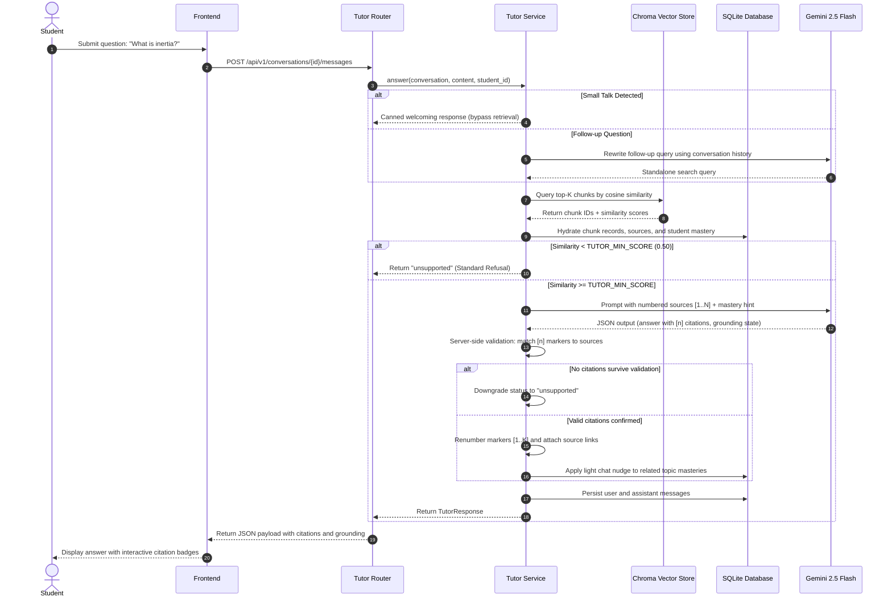

<p align="center">
  <!-- TODO: add logo -->
  <h1 align="center">Folio</h1>
  <p align="center"><strong>Source-grounded AI study companion</strong></p>
  <p align="center">
    Folio is an intelligent, source-grounded learning companion designed to turn unstructured course materials—textbooks, lecture slides, and video transcripts—into an interactive, verifiable academic workspace. Built for deep comprehension and rigorous exam preparation, Folio combines semantic vector retrieval with strict citation provenance, Bayesian Knowledge Tracing (BKT), Ebbinghaus retention decay, adaptive diagnostic assessments, and automated prerequisite remediation.
  </p>
</p>

<p align="center">
  <a href="https://opensource.org/licenses/MIT"></a>
  <a href="https://www.python.org/downloads/"></a>
  <a href="https://fastapi.tiangolo.com/"></a>
  <a href="https://www.sqlite.org/"></a>
  <a href="https://www.trychroma.com/"></a>
  <a href="https://ai.google.dev/"></a>
  <a href="https://react.dev/"></a>
  <a href="https://vitejs.dev/"></a>
  <a href="https://tailwindcss.com/"></a>
  
</p>

---

## Table of Contents

1. [The Problem and Our Solution](#the-problem-and-our-solution)
2. [Key Features](#key-features)
   - [Course Ingestion & Document Intelligence](#course-ingestion--document-intelligence)
   - [Knowledge Base & Prerequisite Graph](#knowledge-base--prerequisite-graph)
   - [Source-Grounded AI Tutor](#source-grounded-ai-tutor)
   - [Adaptive Assessments & Question Verification](#adaptive-assessments--question-verification)
   - [Deterministic & Rubric-Based Grading](#deterministic--rubric-based-grading)
   - [Learner Model & Memory Decay](#learner-model--memory-decay)
   - [Dashboard & Study Planning](#dashboard--study-planning)
   - [Authentication & Tenant Security](#authentication--tenant-security)
   - [Engineering & Code Quality](#engineering--code-quality)
   - [Evaluation Harness](#evaluation-harness)
3. [Tech Stack](#tech-stack)
4. [Architecture](#architecture)
   - [Grounded Tutor Sequence Flow](#grounded-tutor-sequence-flow)
   - [How Grounding Works](#how-grounding-works)
   - [How the Learner Model Works](#how-the-learner-model-works)
5. [Project Structure](#project-structure)
6. [Getting Started](#getting-started)
   - [Prerequisites](#prerequisites)
   - [Backend Setup (with uv)](#backend-setup-with-uv)
   - [Environment Configuration](#environment-configuration)
   - [Mock Mode vs Live Mode](#mock-mode-vs-live-mode)
   - [Frontend Setup](#frontend-setup)
   - [Running Both Services](#running-both-services)
   - [Seeding Demo Data](#seeding-demo-data)
   - [Troubleshooting Guide](#troubleshooting-guide)
7. [API Overview](#api-overview)
   - [Endpoint Groups](#endpoint-groups)
   - [Authentication Header Usage](#authentication-header-usage)
   - [Standard Error Format](#standard-error-format)
   - [Interactive Documentation](#interactive-documentation)
8. [Testing and Evaluation](#testing-and-evaluation)
   - [Verification Suites](#verification-suites)
   - [Evaluation Benchmark Harness](#evaluation-benchmark-harness)
   - [Empirical Results Summary](#empirical-results-summary)
9. [Demo](#demo)
10. [Limitations and Roadmap](#limitations-and-roadmap)
11. [Contributing](#contributing)
12. [License](#license)
13. [Acknowledgments & Team](#acknowledgments--team)

---

## The Problem and Our Solution

**The Problem:**
Students studying complex coursework are overwhelmed by fragmented resources across lengthy textbooks, presentation slides, and hours of video lectures. General-purpose AI chatbots frequently hallucinate plausible-sounding explanations, introduce out-of-syllabus methods that confuse learners, and cannot prove where their statements originate. Furthermore, static self-study lacks adaptive feedback: learners do not know which prerequisite knowledge gaps cause their errors or when memory decay requires targeted review.

**Our Solution:**
Folio transforms course materials into an authenticated, verifiable personal tutor. Every factual statement is strictly grounded with clickable citations linked to specific pages, slides, or timestamped lecture transcripts. Powered by Bayesian Knowledge Tracing (BKT) and an Ebbinghaus retention decay model, Folio continuously tracks student mastery per topic. It generates verified, multi-format assessments (MCQ, rubric short-answer, numerical), diagnoses misconceptions, and automatically generates calendarized study plans that address root-cause prerequisite gaps before scheduled exams.

---

## Key Features

### Course Ingestion & Document Intelligence
- **Multi-Format Parsers:** Ingests academic PDFs (`PyMuPDF`), PowerPoint presentations (`python-pptx`), and lecture transcripts (WebVTT `.vtt`, SubRip `.srt`, YouTube transcript JSON, and plain timestamped `.txt`).
- **Timestamp Seeking:** Binds transcript chunks to optional lecture media URLs for synchronous timecode playback.
- **Content Sniffing & Boundary Limits:** Validates file integrity via magic headers (`%PDF`, ZIP/XML presentation checks, WebVTT signatures) and enforces a 50 MB upload limit (`MAX_UPLOAD_MB=50`).
- **Duplicate Detection:** Computes SHA-256 hashes per file to block duplicate source uploads within the same course.
- **Resilient Background Processing:** Executes parsing, token-bounded chunking, and embedding in background worker threads with live stage progress reporting.
- **One-Click Retry:** Provides a dedicated retry endpoint (`POST /api/v1/sources/{source_id}/retry`) to recover interrupted or failed source uploads.
- **Optional Slide & Figure Captioning:** Extracts embedded slide diagrams and figures meeting minimum dimensions (`IMAGE_MIN_PX=150`) and captions them via Gemini Vision (off by default via `IMAGE_CAPTION_ENABLED=false`).

### Knowledge Base & Prerequisite Graph
- **LLM Taxonomy Synthesis:** Analyzes course chunks using map-reduce prompting to extract a cohesive taxonomy of topics, subtopics, and concepts.
- **Directed Prerequisite Graph:** Derives prerequisite relationships between topics and verifies DAG topology with cycle detection.
- **Fine-Grained Provenance:** Tags every chunk with leaf topics and concepts while storing exact source origins (page number, slide number, timestamp intervals).
- **ID-Stable Rebuilds:** Retains existing database IDs and preserves active student mastery states when rebuilding course knowledge bases.
- **Automatic Ingestion Triggers:** Automatically initiates incremental taxonomy rebuilds when new documents are added (`AUTO_BUILD_KB=true`).
- **Course Flow Map Endpoint:** Exposes `GET /api/v1/courses/{course_id}/graph` delivering node hierarchies, chunk densities, and prerequisite edges for visual rendering.

### Source-Grounded AI Tutor
- **Hybrid Semantic Retrieval:** Queries ChromaDB cosine vector collections filtered by course boundaries and optional topic scopes.
- **Three Grounding States:** Categorizes every answer as `grounded` (substantiated by course chunks), `partial` (course material supplemented with an explicitly marked *"Outside your material:"* section), or `unsupported` (factual refusal when material is absent).
- **Interactive Citations:** Generates bracketed references `[1], [2]` that link directly to exact document pages, presentation slides, or transcript timecodes.
- **Conversational Context & Query Rewriting:** Reformulates ambiguous follow-up questions (resolving pronouns and references) into standalone search queries based on recent dialogue history.
- **Small-Talk Bypassing:** Detects conversational greetings and courtesies via regular expressions, returning instant friendly guidance without running vector retrieval.
- **Pedagogical Level Personalization:** Adjusts explanation depth based on the student's real-time BKT mastery level (foundational concepts for novices; concise, advanced insights for mastered learners).
- **Adversarial & Injection Resistance:** Enforces system-level delimiters and similarity gating (`TUTOR_MIN_SCORE=0.50`) to refuse prompt injection attempts and off-topic queries.
- **Server-Side Citation Validation:** Validates that every citation bracket in the generated text corresponds to an actual retrieved chunk, automatically downgrading unverified claims.

### Adaptive Assessments & Question Verification
- **Multi-Format Assessment Generation:** Dynamically generates Multiple Choice Questions (MCQ), Rubric-Scored Short Answer, and Numerical calculations with tolerances.
- **Assessment Modes:** Creates focused single-topic practice quizzes, multi-topic comprehensive mock exams, and cold-start diagnostic assessments.
- **Second-Pass Blind Verification:** Employs an independent verification pass (with optional separate verifier model `VERIFY_MODEL`) that solves questions blind without viewing the answer key to reject ambiguous questions.
- **Lexical & Semantic Deduplication:** Filters candidate questions against prior student attempts using normalized SHA-256 prompt fingerprints and cosine vector similarity (`QUIZ_DUP_SIMILARITY=0.90`).
- **Shortfall Recovery:** Runs multi-round generation loops (`QUIZ_MAX_ROUNDS=2`) to guarantee the requested question quota is satisfied even if verifiers reject invalid items.
- **Protected Answer Keys:** Masks correct answers and grading rubrics from client payloads until the student submits an answer.

### Deterministic & Rubric-Based Grading
- **Instant Rule-Based Grading:** Grades MCQ responses and numerical inputs (with configurable percentage tolerance) deterministically with zero LLM overhead.
- **Rubric-Based Short-Answer Grading:** Leverages structured LLM evaluation to award fractional partial credit (0.0 to 1.0) against criteria checklists.
- **Grounded Feedback:** Accompanies grading outcomes with feedback citations linked to relevant course reading sections.
- **Misconception Diagnosis:** Pinpoints underlying conceptual errors on incorrect submissions and logs targeted corrective guidance.
- **Post-Assessment Diagnostic Reports:** Aggregates performance by topic, cognitive difficulty, and question format, presenting identified misconceptions and focused study recommendations.

### Learner Model & Memory Decay
- **Bayesian Knowledge Tracing (BKT):** Updates latent topic mastery probability $P(L)$ after every practice event, factoring in slip parameters modulated by question difficulty and guess probabilities based on question type.
- **Continuous Soft Updates:** Smoothly scales Bayesian updates for partial credit scores using linear interpolation between correct and incorrect posteriors.
- **Read-Time Forgetting Curve:** Calculates memory retention decay at query time using an Ebbinghaus exponential model without mutating stored mastery values.
- **Capped Chat Mastery Nudges:** Applies subtle mastery increments when students engage productively with the grounded tutor, capped at $0.55$ to prevent chat exploitation.
- **Cold-Start Diagnostic:** Quickly bootstraps student mastery profiles across the syllabus upon course enrollment.

### Dashboard & Study Planning
- **Readiness & Mastery Heatmaps:** Visualizes topics classified as *New*, *Learning*, *Weak* ($< 0.40$), and *Strong* ($> 0.75$).
- **Spaced Review Tracking:** Automatically flags practiced topics whose retrievability has decayed below threshold (`REVIEW_DUE_BELOW=0.70`).
- **Activity & Streak Metrics:** Summarizes daily study sessions, question attempt counts, and historical score trajectories.
- **Prerequisite Root-Cause Recommendations:** Rule engine traces weak topics back to their earliest unmastered prerequisite and recommends remediating foundations first.
- **Calendarized Study Planner:** Generates multi-day study schedules (up to 60 days) factoring in daily available time, spaced review intervals (Day +2, Day +5), and pre-exam mock assessments.

### Authentication & Tenant Security
- **JWT Bearer Authentication:** Generates cryptographically signed access tokens with configurable expiration (`JWT_EXPIRE_MINUTES=10080`).
- **Argon2 Password Hashing:** Secures credentials with the state-of-the-art Argon2 password hashing algorithm, including dummy timing verification to prevent user enumeration attacks.
- **Enforced Password Complexity:** Enforces passwords of 8–128 characters containing uppercase, lowercase, and special symbols.
- **Brute-Force Account Lockout:** Single-process rate limiting locks out accounts for 15 minutes after 5 consecutive failed login attempts.
- **Strict Data Isolation:** Ensures students can access and manipulate only their own conversations, assessments, attempts, and mastery profiles.

### Engineering & Code Quality
- **Standard Error Payloads:** Standardizes all API exceptions into a structured format: `{"error": {"code": "...", "message": "..."}}`.
- **Request Tracing:** Generates and returns a unique `X-Request-ID` header on every request for distributed observability and log correlation.
- **Concurrency & Concurrency Protection:** Employs thread-level locking on student mastery updates and asynchronous background build locks on course taxonomies.
- **Automated OpenAPI Validation:** Validates that every production endpoint includes tags and explicit Pydantic response models via `scripts/export_openapi.py`.
- **Developer Integrity Endpoints:** Includes administrative tools (`/api/v1/dev`) to trigger vector collection resets, inspect database integrity, and run synthetic BKT simulations.
- **Comprehensive Offline Mock Mode:** Provides complete offline execution (`LLM_MOCK=true`) supporting local development, zero-token testing, and CI/CD pipelines.
- **Automated Verification Harness:** Ships with 9 specialized verification scripts testing all functional boundaries.
- **Demo Scenario Seeder:** Seeds realistic academic data (PHYS101 Classical Mechanics) with sample documents and historical student trajectories via `scripts/seed_demo.py`.

### Evaluation Harness
- **Retrieval & Refusal Benchmarks:** Evaluates Hit@K, MRR, Context Precision, Context Recall, Citation Accuracy, and Refusal Precision/Recall/F1 over gold test sets.
- **Generation Quality Evaluation:** Benchmarks tutor answers using RAGAS generation metrics alongside a deterministic offline judge (`custom_judge`).
- **Question Quality Auditing:** Validates question verifier acceptance rates, semantic deduplication drop rates, and blind-solve agreement.
- **30-Day Simulated Personalization Study:** Simulates 4 diverse student archetypes (Crammer, Steady, Struggling, Fast) across personalized (Folio) and non-personalized control cohorts.

---

## Tech Stack

| Layer | Technology | Version | Purpose |
| :--- | :--- | :--- | :--- |
| **Frontend Framework** | [](https://react.dev/) | `^19.2.8` | Component-driven user interface with hooks and strict typing |
| **Frontend Tooling** | [](https://vitejs.dev/) | `^8.3.0` | Local development server and optimized production bundler |
| **Styling** | [](https://tailwindcss.com/) | `^4.3.3` | Utility-first responsive CSS styling with dark mode tokens |
| **Routing & UI** | [](https://reactrouter.com/) | `^7.18.4` | Client-side routing, navigation shells, and parameter management |
| **Icons** | [](https://lucide.dev/) | `^1.56.0` | Lightweight, consistent UI icon library |
| **Backend Framework** | [](https://fastapi.tiangolo.com/) | `>=0.143.0` | High-performance asynchronous REST API with automatic OpenAPI generation |
| **Package Manager** | [](https://github.com/astral-sh/uv) | Latest | Ultra-fast Python package resolution and virtual environment management |
| **Data Validation** | [](https://docs.pydantic.dev/) | `>=2.14.1` | Data parsing, schema validation, and typed environment settings |
| **Database & ORM** | [](https://www.sqlalchemy.org/) | `>=2.1.4` | Relational ORM mapping with SQLite connection pooling and WAL mode |
| **Vector Store** | [](https://www.trychroma.com/) | `>=1.5.9` | Embedded vector database with cosine distance indexing for chunks and questions |
| **AI / LLM Engine** | [](https://ai.google.dev/) | `>=2.30.0` | SDK for Gemini 2.5 Flash generation, structured JSON, and embeddings |
| **Document Parsing** | [](https://pymupdf.readthedocs.io/) | `>=1.28.2` | High-speed PDF text, layout, and image extraction |
| **Presentation Parsing**| [](https://python-pptx.readthedocs.io/) | `>=1.0.2` | PowerPoint slide text, speaker notes, and shape extraction |
| **Security & Auth** | [](https://github.com/hynek/argon2-cffi) | `>=25.1.0` | Cryptographic password hashing and timing attack mitigation |
| **Token Handling** | [](https://pyjwt.readthedocs.io/) | `>=2.15.1` | RFC 7519 compliant JSON Web Token encoding, decoding, and validation |
| **Evaluation Suite** | [](https://docs.ragas.io/) | `>=0.4.3` | RAG assessment framework measuring faithfulness, recall, and precision |

---

## Architecture

### Grounded Tutor Sequence Flow



### How Grounding Works

1. **Query Formulation & Gating:** When a question is submitted, Folio inspects recent conversation turns. If the prompt is a follow-up, an LLM query rewriter translates it into a standalone query. Folio retrieves the top 8 chunks from ChromaDB. If the highest cosine similarity score falls below `TUTOR_MIN_SCORE` ($0.50$), Folio short-circuits the pipeline and issues an immediate factual refusal (*"I couldn't find this in your course material"*).
2. **Pedagogical Prompt Synthesis:** If the similarity gate passes, Folio formats the retrieved chunks with sequential numeric markers `[1]`, `[2]`, accompanied by the student's mastery level in the relevant topics (to calibrate explanation depth).
3. **Structured Response & Delimited Knowledge:** The LLM is instructed to answer strictly using the provided sources. If course material is incomplete but the question can be partially addressed, out-of-syllabus knowledge must be isolated in an explicit *"Outside your material:"* section.
4. **Server-Side Verification & Marker Renumbering:** Folio parses all bracketed citation markers `[n]` in the model's output. Any citation referencing an unretrieved chunk is discarded. The markers are renumbered consecutively. If the model claims `grounded` or `partial` status but zero citations survive validation, Folio automatically downgrades the grounding state to `unsupported` and substitutes the standard refusal text.

### How the Learner Model Works

#### Bayesian Knowledge Tracing (BKT)
Folio tracks student understanding per topic using a standard 4-parameter BKT model:
- **Prior Mastery:** $P(L_0) = 0.30$ (`BKT_P_INIT`)
- **Transition Probability:** $P(T) = 0.15$ (`BKT_P_LEARN`)
- **Slip Probability:** Base $P(S) = 0.10$ (`BKT_P_SLIP`), modulated by question difficulty:
  $$\text{slip} = P(S) \times \begin{cases} 1.5 & \text{if easy} \\ 1.0 & \text{if medium} \\ 0.6 & \text{if hard} \end{cases}$$
- **Guess Probability:** $P(G)$ determined by question format:
  $$\text{guess} = \begin{cases} 0.25 & \text{for MCQ} \\ 0.10 & \text{for Short Answer} \\ 0.05 & \text{for Numerical} \end{cases}$$

When an assessment question is submitted, the posterior mastery is computed:
$$P(L \mid \text{correct}) = \frac{P(L) \cdot (1 - \text{slip})}{P(L) \cdot (1 - \text{slip}) + (1 - P(L)) \cdot \text{guess}}$$
$$P(L \mid \text{wrong}) = \frac{P(L) \cdot \text{slip}}{P(L) \cdot \text{slip} + (1 - P(L)) \cdot (1 - \text{guess})}$$

For partial credit scores $s \in [0.0, 1.0]$, Folio performs continuous linear interpolation:
$$P(L \mid \text{obs}) = s \cdot P(L \mid \text{correct}) + (1 - s) \cdot P(L \mid \text{wrong})$$

The updated mastery accounts for the learning transition and is clamped to $[0.02, 0.98]$:
$$P(L_{t+1}) = \text{clamp}\Big(P(L \mid \text{obs}) + (1 - P(L \mid \text{obs})) \cdot P(T), \; 0.02, \; 0.98\Big)$$

#### Ebbinghaus Retention Decay (Read-Time Forgetting)
Rather than writing constant updates to the database, Folio computes effective mastery on read:
1. **Memory Stability (in days):**
   $$S = \min\Big(\text{FORGET\_MAX\_DAYS}, \; \text{FORGET\_BASE\_DAYS} \times (1 + \text{FORGET\_PER\_CORRECT} \times \text{correct\_count})\Big)$$
   *(Defaults: base 3 days, +0.5 days per correct answer, capped at 60 days).*
2. **Retrievability:**
   $$R(t) = \exp\left(-\frac{\Delta t}{S}\right)$$
   where $\Delta t$ is elapsed days since the topic was last practiced.
3. **Effective Decayed Mastery:**
   $$\text{Eff}(P(L)) = \begin{cases} P(L_0) + (P(L) - P(L_0)) \times R(t) & \text{if } P(L) > P(L_0) \\ P(L) & \text{otherwise} \end{cases}$$
   *Decay gradually pulls mastery toward the initial prior $P(L_0) = 0.30$, but never lowers it below the prior or elevates poor mastery.*
4. **Review Threshold:** A topic is flagged as *Due for Review* when $\text{attempts} > 0$ and $R(t) < 0.70$ (`REVIEW_DUE_BELOW`).

---

## Project Structure

```text
Folio/
├── backend/                       # FastAPI backend application
│   ├── app/
│   │   ├── api/
│   │   │   └── routes/            # REST API route handlers
│   │   │       ├── assessments.py # Quizzes, mock exams, diagnostics
│   │   │       ├── auth.py        # Signup, login, profile, password change
│   │   │       ├── chunks.py      # Chunk viewer and source text inspection
│   │   │       ├── courses.py     # Course creation and management
│   │   │       ├── dev.py         # Developer tools, vector reset, simulations
│   │   │       ├── health.py      # Health checks and uptime probes
│   │   │       ├── kb.py          # Knowledge base status, graph, topics
│   │   │       ├── learner.py     # Dashboard, mastery heatmap, study plan
│   │   │       ├── meta.py        # System capabilities and model metadata
│   │   │       ├── sources.py     # Document upload, parsing, and chunking
│   │   │       ├── students.py    # Student profile management
│   │   │       └── tutor.py       # Grounded tutor chat and query rewrite
│   │   ├── core/                  # Application configuration and errors
│   │   │   ├── config.py          # Pydantic Settings loaded from .env
│   │   │   └── errors.py          # AppError exception and JSON handlers
│   │   ├── db/                    # SQLAlchemy database engine and session
│   │   │   └── session.py         # SQLite connection and migration runner
│   │   ├── models/                # SQLAlchemy database entities
│   │   │   ├── assessment.py      # Assessment, Question, Attempt models
│   │   │   ├── conversation.py    # Conversation and Message models
│   │   │   ├── course.py          # Course entity
│   │   │   ├── mastery.py         # Mastery and MasteryEvent audit log
│   │   │   ├── source.py          # Source and Chunk models
│   │   │   ├── student.py         # Student account and password hash
│   │   │   └── topic.py           # Topic, Concept, Prerequisite DAG models
│   │   ├── schemas/               # Pydantic request and response schemas
│   │   └── services/              # Domain business logic
│   │       ├── assessment/        # Question generation, verifier, dedupe
│   │       ├── auth/              # JWT tokens, Argon2 hashing, rate limits
│   │       ├── grading/           # Rule, rubric, and numerical grading
│   │       ├── ingestion/         # PDF, PPTX, and transcript parsers
│   │       ├── kb/                # Taxonomy synthesis and DAG builder
│   │       ├── learner/           # BKT update, Ebbinghaus decay, planner
│   │       ├── tutor/             # Grounding pipeline, query rewrite, citations
│   │       ├── llm.py             # Google GenAI wrapper with mock support
│   │       └── vector_store.py    # ChromaDB persistent collection wrapper
│   ├── eval/                      # Evaluation harness & benchmark suites
│   │   ├── personalization/       # 30-day student simulation & metrics
│   │   ├── generation.py          # RAGAS and custom LLM judge evaluation
│   │   ├── quiz.py                # Quiz question quality audit
│   │   ├── retrieval.py           # Retrieval Hit@K and refusal metrics
│   │   ├── run.py                 # CLI entrypoint for evaluation suites
│   │   └── testset.sample.json    # Gold evaluation test set
│   ├── eval_results/              # Persisted evaluation outputs and charts
│   ├── samples/                   # Sample course documents (PDF, PPTX, transcripts)
│   ├── scripts/                   # Verification runners and administration
│   │   ├── export_openapi.py      # Validates and exports openapi.json
│   │   ├── seed_demo.py           # Seeds PHYS101 course and demo students
│   │   ├── verify_all.py          # Master test runner for all 9 suites
│   │   └── verify_*.py            # Subsystem verification scripts
│   ├── openapi.json               # Exported OpenAPI 3.1 specification
│   ├── pyproject.toml             # Python dependencies and project metadata
│   └── uv.lock                    # Locked dependency resolution
├── frontend/                      # React 19 / Vite frontend application
│   ├── public/                    # Static assets, SVG icons, and favicons
│   ├── src/
│   │   ├── api/                   # Typed API client and fetch wrappers
│   │   ├── app/                   # Root application shell and providers
│   │   ├── assets/                # Hero illustrations and vector graphics
│   │   ├── components/            # Reusable UI components and layouts
│   │   ├── context/               # Auth, Course, and Student state providers
│   │   ├── pages/                 # Route views (Dashboard, Tutor, Quiz, etc.)
│   │   └── types/                 # TypeScript interfaces and API schemas
│   ├── package.json               # Node.js dependencies and scripts
│   ├── tsconfig.json              # TypeScript compilation config
│   └── vite.config.ts             # Vite bundler configuration
├── CONTRIBUTING.md                # Development workflow and PR guidelines
├── LICENSE                        # MIT License text
└── README.md                      # Project documentation
```

---

## Getting Started

### Prerequisites

- **Python:** 3.12 or newer (`python3 --version`)
- **uv:** Ultra-fast Python package installer (`curl -LsSf https://astral.sh/uv/install.sh | sh`)
- **Node.js:** 18.x, 20.x, or 22.x LTS with `npm` (`node --version`)
- **Gemini API Key:** Optional for mock mode; required for live LLM generation. Obtainable from [Google AI Studio](https://aistudio.google.com/).

### Backend Setup (with uv)

#### macOS / Linux
```bash
# Navigate to the backend directory
cd backend

# Synchronize virtual environment with uv
uv sync

# Create your local environment file
cp .env.example .env

# Start the development server
uv run uvicorn app.main:app --reload --host 0.0.0.0 --port 8000
```

#### Windows (PowerShell)
```powershell
# Navigate to the backend directory
cd backend

# Synchronize virtual environment with uv
uv sync

# Create your local environment file
Copy-Item .env.example .env

# Start the development server
uv run uvicorn app.main:app --reload --host 0.0.0.0 --port 8000
```

### Environment Configuration

Key configuration parameters defined in `backend/.env.example`:

| Environment Variable | Default Value | Description |
| :--- | :--- | :--- |
| `GEMINI_API_KEY` | *(empty)* | Google Gemini API key from Google AI Studio |
| `LLM_MODEL` | `gemini-2.5-flash` | Primary Gemini model for generation and reasoning |
| `EMBEDDING_MODEL` | `gemini-embedding-001`| Model used for semantic text embeddings |
| `LLM_MOCK` | `true` | When `true`, runs fully offline with deterministic mock outputs |
| `DATABASE_URL` | `sqlite:///./storage/folio.db` | SQLite database file location |
| `UPLOAD_DIR` | `./storage/uploads` | Directory for uploaded course files |
| `CHROMA_DIR` | `./storage/chroma` | Persistent storage directory for ChromaDB vector indices |
| `CORS_ORIGINS` | `http://localhost:3000,http://localhost:5173` | Allowed CORS origins for frontend web clients |
| `MAX_UPLOAD_MB` | `50` | Maximum allowed file upload size in megabytes |
| `CHUNK_TARGET_TOKENS` | `400` | Target token size per chunk during ingestion |
| `CHUNK_OVERLAP_TOKENS` | `50` | Token overlap between consecutive chunks |
| `AUTO_BUILD_KB` | `true` | Automatically rebuild knowledge base upon new source upload |
| `TUTOR_TOP_K` | `8` | Number of chunks retrieved for tutor context |
| `TUTOR_MIN_SCORE` | `0.50` | Cosine similarity threshold; queries below this are refused |
| `VERIFY_MODEL` | *(empty)* | Optional separate model for question verification (e.g. `gemini-2.5-pro`) |
| `QUIZ_DUP_SIMILARITY`| `0.90` | Cosine similarity threshold for question deduplication |
| `BKT_P_INIT` | `0.30` | Initial prior mastery probability for new topics |
| `BKT_P_LEARN` | `0.15` | Transition probability of acquiring knowledge per attempt |
| `BKT_P_SLIP` | `0.10` | Base probability of slipping on a known concept |
| `REVIEW_DUE_BELOW` | `0.70` | Memory retrievability threshold below which review is due |
| `AUTH_REQUIRED` | `true` | Enforces JWT authentication on protected endpoints |
| `JWT_SECRET` | `change-me-in-.env` | Secret key for signing authentication tokens |
| `IMAGE_CAPTION_ENABLED`| `false` | Enables multimodal slide/figure captioning |

<details>
<summary>Click to view full list of advanced tuning parameters</summary>

| Variable | Default | Purpose |
| :--- | :--- | :--- |
| `DEBUG` | `true` | Enables detailed logging and `/dev` endpoints |
| `TRANSCRIPT_WINDOW_SEC` | `60` | Time window (seconds) for grouping transcript cues |
| `KB_BATCH_TOKENS` | `6000` | Token window size for knowledge base map batches |
| `KB_MAX_TOPLEVEL` | `10` | Maximum top-level topics in course taxonomy |
| `KB_MAX_SUBTOPICS` | `5` | Maximum subtopics per parent topic |
| `SNIPPET_CHARS` | `300` | Snippet character length stored in citations |
| `TUTOR_HISTORY_TURNS` | `6` | Maximum message pairs passed to query rewriter |
| `TUTOR_CONTEXT_CHARS` | `1500` | Context character limit per source chunk in tutor prompt |
| `QUIZ_MAX_QUESTIONS` | `20` | Default question limit for standard quizzes |
| `EXAM_MAX_QUESTIONS` | `40` | Default question limit for mock exams |
| `DIAGNOSTIC_QUESTIONS` | `8` | Question count for initial diagnostic |
| `QUIZ_PARALLELISM` | `3` | Parallel workers for multi-topic question generation |
| `MASTERY_WEAK_BELOW` | `0.40` | Mastery threshold classifying a topic as weak |
| `MASTERY_STRONG_ABOVE`| `0.75` | Mastery threshold classifying a topic as strong |
| `FEEDBACK_MAX_CHARS` | `700` | Maximum character length for grading feedback |
| `FORGET_BASE_DAYS` | `3.0` | Base memory stability in days for forgetting curve |
| `FORGET_PER_CORRECT` | `0.5` | Stability multiplier added per correct answer |
| `FORGET_MAX_DAYS` | `60.0` | Maximum stability cap in days |
| `PREREQ_OK_ABOVE` | `0.50` | Mastery threshold for considering a prerequisite satisfied |
| `CHAT_NUDGE_ENABLED` | `true` | Enables subtle mastery gains from positive tutor chat |
| `CHAT_NUDGE_DELTA` | `0.02` | Mastery increment awarded per grounded chat interaction |
| `CHAT_NUDGE_CAP` | `0.55` | Maximum mastery attainable via chat nudges alone |
| `AUTH_MAX_FAILED_ATTEMPTS` | `5` | Maximum failed logins before temporary lockout |
| `AUTH_LOCKOUT_MINUTES` | `15` | Duration of brute-force lockout window |

</details>

### Mock Mode vs Live Mode

Folio is designed with full **mock parity**: every LLM generation, vector embedding, and verification function has an offline equivalent.

- **Offline Mock Mode (`LLM_MOCK=true`):**
  - Generates 64-dimensional lexical unit embeddings deterministically.
  - Zero API calls; runs offline with zero latency and zero billing cost.
  - Ideal for local frontend development, unit testing, and CI/CD pipelines.
- **Live Gemini Mode (`LLM_MOCK=false`):**
  - Requires a valid `GEMINI_API_KEY`.
  - Computes 768-dimensional embeddings using `gemini-embedding-001`.
  - Generates responses and evaluates rubrics using `gemini-2.5-flash`.

> [!WARNING]
> **Vector Dimension Mismatch when Switching Modes:**
> Switching between Mock Mode (64 dimensions) and Live Mode (768 dimensions) without resetting ChromaDB will raise an `embedding_dim_mismatch` error.
> Always reset vector collections after changing `LLM_MOCK`:
> ```bash
> curl -X POST http://localhost:8000/api/v1/dev/vector-reset
> ```
> *Alternatively, delete the directory `backend/storage/chroma` while the backend is stopped.*

### Frontend Setup

```bash
# Navigate to the frontend directory
cd frontend

# Install dependencies
npm install

# Start Vite development server
npm run dev
```

The frontend will run at `http://localhost:5173`.

### Running Both Services

1. **Terminal 1 (Backend):**
   ```bash
   cd backend && uv run uvicorn app.main:app --reload --port 8000
   ```
2. **Terminal 2 (Frontend):**
   ```bash
   cd frontend && npm run dev
   ```
3. Open `http://localhost:5173` in your browser.

### Seeding Demo Data

To populate the system with a complete course, sample materials, topics, and two pre-configured student profiles:

```bash
cd backend
python scripts/seed_demo.py --reset
```

#### Demo User Credentials (from `scripts/seed_demo.py`)

| Student Role | Email | Password | Pre-configured State |
| :--- | :--- | :--- | :--- |
| **Active Student** | `demo.active@folio.demo` | `Demo@1234` | 14-day history, mastered & struggling topics, chat logs, graded quizzes |
| **New Student** | `demo.new@folio.demo` | `Demo@1234` | Fresh account ready for initial diagnostic assessment |

### Troubleshooting Guide

- **Error: `embedding_dim_mismatch` (Status 400):**
  - *Cause:* Switched between mock mode and live Gemini mode. Chroma collections have incompatible dimension metadata.
  - *Fix:* Run `curl -X POST http://localhost:8000/api/v1/dev/vector-reset` and re-upload course materials.
- **Error: `429 Too Many Requests` or `503 Service Unavailable` from Gemini:**
  - *Cause:* Google AI Studio API rate limits or transient service congestion.
  - *Behavior:* Folio automatically performs exponential backoff across 3 retries (delays: 2s, 4s, 8s). If quota is completely exhausted, switch to `LLM_MOCK=true` or verify billing in Google AI Studio.
- **Error: Model name not found:**
  - *Cause:* Misconfigured `LLM_MODEL` or `EMBEDDING_MODEL` in `.env`.
  - *Fix:* Ensure model strings match current Google GenAI names (`gemini-2.5-flash`, `gemini-embedding-001`).
- **Knowledge Base Build Failure:**
  - *Cause:* Document ingestion failed, was interrupted by server restart, or contains unsupported structures.
  - *Fix:* Check `GET /api/v1/courses/{course_id}/kb/status` for `kb_error`. Trigger a clean synchronous rebuild via `POST /api/v1/courses/{course_id}/kb/rebuild`.

---

## API Overview

### Endpoint Groups

| Group | Base Route | Key Endpoints | Description |
| :--- | :--- | :--- | :--- |
| **Authentication** | `/api/v1/auth` | `POST /signup`<br>`POST /login`<br>`GET /me`<br>`POST /change-password` | JWT token management, Argon2 verification, user registration |
| **Courses** | `/api/v1/courses` | `GET /`<br>`POST /`<br>`GET /{id}`<br>`DELETE /{id}` | Course creation, listing, and lifecycle management |
| **Sources & Ingestion**| `/api/v1/courses/{id}/sources` | `POST /`<br>`GET /`<br>`GET /sources/{id}`<br>`POST /sources/{id}/retry` | Document upload (PDF/PPTX/transcripts), status, and retry |
| **Knowledge Base** | `/api/v1/courses/{id}` | `GET /kb/status`<br>`POST /kb/rebuild`<br>`GET /topics`<br>`GET /graph` | Taxonomy status, rebuild trigger, and topic relationship DAG |
| **Chunks** | `/api/v1/chunks` | `GET /{chunk_id}` | Inspection of parsed chunks, source metadata, and tokens |
| **Grounded Tutor** | `/api/v1` | `POST /courses/{id}/conversations`<br>`POST /conversations/{id}/messages` | Tutor chat sessions, query rewrite, grounded answers |
| **Assessments** | `/api/v1` | `POST /courses/{id}/assessments`<br>`POST /assessments/{id}/questions/{qid}/answer`<br>`POST /assessments/{id}/submit`<br>`GET /assessments/{id}/report` | Quiz generation, question-by-question answering, report generation |
| **Learner Model** | `/api/v1/students/{sid}/courses/{cid}` | `GET /dashboard`<br>`GET /mastery`<br>`GET /recommendations`<br>`GET /study-plan` | BKT readiness, retention heatmaps, root-cause recommendations, planner |
| **Developer Tools** | `/api/v1/dev` | `POST /vector-reset`<br>`POST /reembed-all`<br>`GET /integrity-check` | Database diagnostics, vector resets, simulation tools |
| **System Health** | `/health`, `/api/v1/meta` | `GET /health`<br>`GET /api/v1/meta` | Liveness probe and runtime capability discovery |

<details>
<summary>Click to view complete route inventory (52 endpoints)</summary>

```text
POST   /api/v1/auth/signup
POST   /api/v1/auth/login
GET    /api/v1/auth/me
POST   /api/v1/auth/change-password
GET    /health
GET    /api/v1/health
GET    /api/v1/meta
GET    /api/v1/students
POST   /api/v1/students
GET    /api/v1/students/{student_id}
DELETE /api/v1/students/{student_id}
GET    /api/v1/courses
POST   /api/v1/courses
GET    /api/v1/courses/{course_id}
DELETE /api/v1/courses/{course_id}
POST   /api/v1/courses/{course_id}/sources
GET    /api/v1/courses/{course_id}/sources
GET    /api/v1/sources/{source_id}
DELETE /api/v1/sources/{source_id}
GET    /api/v1/sources/{source_id}/chunks
GET    /api/v1/sources/{source_id}/file
POST   /api/v1/sources/{source_id}/retry
GET    /api/v1/chunks/{chunk_id}
GET    /api/v1/courses/{course_id}/kb/status
POST   /api/v1/courses/{course_id}/kb/rebuild
GET    /api/v1/courses/{course_id}/topics
GET    /api/v1/topics/{topic_id}
GET    /api/v1/courses/{course_id}/concepts
GET    /api/v1/courses/{course_id}/graph
POST   /api/v1/courses/{course_id}/conversations
GET    /api/v1/courses/{course_id}/conversations
GET    /api/v1/conversations/{conversation_id}
DELETE /api/v1/conversations/{conversation_id}
GET    /api/v1/conversations/{conversation_id}/messages
POST   /api/v1/conversations/{conversation_id}/messages
POST   /api/v1/courses/{course_id}/assessments
GET    /api/v1/courses/{course_id}/assessments
POST   /api/v1/courses/{course_id}/diagnostic
GET    /api/v1/assessments/{assessment_id}
DELETE /api/v1/assessments/{assessment_id}
POST   /api/v1/assessments/{assessment_id}/questions/{question_id}/answer
POST   /api/v1/assessments/{assessment_id}/submit
GET    /api/v1/assessments/{assessment_id}/report
GET    /api/v1/students/{student_id}/courses/{course_id}/dashboard
GET    /api/v1/students/{student_id}/courses/{course_id}/mastery
GET    /api/v1/students/{student_id}/courses/{course_id}/topics/{topic_id}/mastery-history
GET    /api/v1/students/{student_id}/courses/{course_id}/recommendations
GET    /api/v1/students/{student_id}/courses/{course_id}/study-plan
GET    /api/v1/students/{student_id}/courses/{course_id}/history
POST   /api/v1/dev/vector-reset
POST   /api/v1/dev/reembed-all
GET    /api/v1/dev/integrity-check
```

</details>

### Authentication Header Usage

All protected endpoints require a standard HTTP `Authorization` header containing a valid Bearer token:

```http
Authorization: Bearer <access_token>
```

Tokens are obtained by authenticating against `POST /api/v1/auth/login` or `POST /api/v1/auth/signup`.

### Standard Error Format

Folio returns a uniform error structure across all 4xx and 5xx responses:

```json
{
  "error": {
    "code": "invalid_answer",
    "message": "Please select a valid option letter (A, B, C, or D)."
  }
}
```

Common error codes:
- `unauthorized` (401): Missing or expired JWT token.
- `not_found` (404): Requested entity does not exist.
- `duplicate_source` (409): Document with identical SHA-256 already exists in course.
- `file_too_large` (413): File upload exceeds `MAX_UPLOAD_MB`.
- `unsupported_file_type` (415): File extension or magic byte header not supported.
- `too_many_attempts` (429): Account locked due to repeated failed logins.
- `embedding_dim_mismatch` (400): Incompatible vector dimensions in Chroma collection.

Every HTTP response also includes an `X-Request-ID` header for distributed tracing.

### Interactive Documentation

FastAPI automatically serves interactive API explorers:
- **Swagger UI:** `http://localhost:8000/docs`
- **ReDoc:** `http://localhost:8000/redoc`
- **Exported Schema:** Available in the repository at [backend/openapi.json](backend/openapi.json).

---

## Testing and Evaluation

### Verification Suites

Folio includes 9 modular test suites in `backend/scripts/`. Run all suites concurrently:

```bash
cd backend
python scripts/verify_all.py
```

To run individual verification scripts:
- Ingestion & Parsers: `python scripts/verify_ingestion.py`
- Knowledge Base & Embeddings: `python scripts/verify_kb.py`
- Grounded Tutor & Citations: `python scripts/verify_tutor.py`
- Question Generation & Verifier: `python scripts/verify_quiz.py`
- Grading, Rubrics & BKT Updates: `python scripts/verify_grading.py`
- Personalization & Forgetting Decay: `python scripts/verify_learner.py`
- Hardening & Request Tracing: `python scripts/verify_final.py`
- Live LLM Contract & Signatures: `python scripts/verify_llm_contract.py`
- Authentication & Security Isolation: `python scripts/verify_auth.py`

### Evaluation Benchmark Harness

Folio includes a comprehensive evaluation harness in `backend/eval/run.py` to assess retrieval accuracy, generation faithfulness, question validity, and longitudinal learning efficiency.

> [!NOTE]
> Evaluation executions in **Mock Mode** verify pipeline plumbing and schema conformity. Quality benchmark metrics and confidence intervals reflect live evaluations against actual LLM judges and gold test sets. Personalization trajectory simulations are synthetic longitudinal agent models.

Run the evaluation suites:

```bash
# Run all evaluation suites against the active course
python -m eval.run --suite all

# Run specific suites
python -m eval.run --suite retrieval
python -m eval.run --suite generation
python -m eval.run --suite quiz
python -m eval.run --suite personalization

# Limit samples for rapid smoke testing
python -m eval.run --suite all --samples 5
```

### Empirical Results Summary

*Source: Real evaluation results from [backend/eval_results/summary.txt](backend/eval_results/summary.txt)*

#### 1. Retrieval & Refusal Suite ($N=18$)
Evaluated against `eval/testset.sample.json` covering supported queries and adversarial out-of-syllabus refusal queries:

| Metric | Mean | 95% Confidence Interval | Samples |
| :--- | :--- | :--- | :--- |
| **Hit@1** | `0.6154` | `[0.3827, 0.8462]` | 13 |
| **Hit@3** | `0.6154` | `[0.3827, 0.8462]` | 13 |
| **Hit@5** | `0.7692` | `[0.5385, 1.0000]` | 13 |
| **Mean Reciprocal Rank (MRR)** | `0.6538` | `[0.4038, 0.8654]` | 13 |
| **Context Recall** | `0.7692` | `[0.5385, 1.0000]` | 13 |
| **Citation Accuracy** | `0.6154` | `[0.3827, 0.8462]` | 13 |
| **Refusal Precision** | `0.3333` | `[0.3333, 0.3333]` | 18 |
| **Refusal Recall** | `1.0000` | `[1.0000, 1.0000]` | 18 |
| **Refusal F1** | `0.5000` | `[0.5000, 0.5000]` | 18 |

#### 2. Tutor Generation Suite (`custom_judge`, $N=13$)
Evaluated using Folio's deterministic judge measuring semantic overlap, keyword grounding, and answer relevance:

| Metric | Mean | Std Dev | 95% Confidence Interval |
| :--- | :--- | :--- | :--- |
| **Faithfulness** | `0.6859` | `0.2441` | `[0.5564, 0.8192]` |
| **Answer Relevancy** | `0.9200` | `0.0000` | `[0.9200, 0.9200]` |
| **Context Precision** | `0.3077` | `0.3055` | `[0.1538, 0.4872]` |
| **Context Recall** | `0.8077` | `0.2433` | `[0.6913, 0.9231]` |
| **Flagged for Review (Score < 0.70)** | `6` items | — | Output in `tutor_flagged.json` |

#### 3. Quiz Generation Suite ($N=16$)
- **Verifier Acceptance Rate:** `93.75%` ($0.9375$)
- **Deduplication Drop Rate:** `0.00%` ($0.0$)
- **Blind-Solve Agreement:** `100.0%` ($1.0$)
- **Difficulty Calibration:** 11 medium requested $\to$ judged medium, 4 requested medium $\to$ judged hard.

#### 4. Personalization 30-Day Simulation (Arm A: Folio Adaptive vs Arm B: Control)
Simulated across 4 learner archetypes over a 30-day curriculum:
- **Overall Just-in-Time Review Rate:** Arm A = `30.0%`, Arm B = `20.4%` (**Relative Gain: +47.3%**)

| Learner Archetype | Arm A Day 30 Eff Mastery | Arm B Day 30 Eff Mastery | Arm A JIT Rate | Arm B JIT Rate |
| :--- | :--- | :--- | :--- | :--- |
| **Crammer** | `0.4029` | `0.5870` | `20.7%` | `33.3%` |
| **Steady Learner** | `0.9399` | `0.7733` | `32.9%` | `19.5%` |
| **Struggling Learner** | `0.3982` | `0.4261` | `16.1%` | `15.5%` |
| **Fast Learner** | `0.4498` | `0.5806` | `52.5%` | `21.6%` |

---

## Demo

<!-- TODO: add demo video link -->
🎥 **Watch the Demo Video:** [PLACEHOLDER] *(coming soon)*

---

## Limitations and Roadmap

### Known Limitations

1. **No Scanned Document OCR:** PDF ingestion relies on `PyMuPDF` text extraction. Non-searchable scanned PDFs without an embedded OCR text layer will parse as empty.
2. **Single-Process In-Memory State:** Rate limiters and course build locks reside in process memory. Clustered multi-instance deployments require Redis for state coordination.
3. **Shared Course Model:** Courses and knowledge bases are globally shared across students rather than isolated per tenant.
4. **Basic Authentication Lifecycle:** JWT implementation does not currently issue refresh tokens, password reset flows, or email verification.
5. **Non-Streaming Tutor Responses:** Tutor chat answers are returned as complete JSON payloads rather than streaming token-by-token.
6. **SQLite Storage Backend:** SQLite WAL mode handles concurrent readers efficiently but serializes concurrent writes under heavy load.
7. **Synthetic Evaluation Metrics:** Personalization trajectories in the evaluation suite represent simulated agent runs rather than real student trials.
8. **Optional Image Captioning:** Multimodal vision captioning for figures is disabled by default to conserve API quota.

### Project Roadmap

- [ ] **Tesseract / Cloud Vision OCR:** Integrate an OCR pipeline for scanned historical course materials and hand-annotated slides.
- [ ] **Streaming Responses (SSE):** Enable Server-Sent Events for real-time token streaming in tutor chat.
- [ ] **Audio Tutoring & Voice Interaction:** Provide bidirectional speech-to-speech tutoring using Gemini Multimodal Live API.
- [ ] **Indic Language UX:** Add comprehensive multilingual localization for Hindi and regional Indian languages.
- [ ] **PostgreSQL & pgvector Support:** Support production PostgreSQL databases with native vector indexing.
- [ ] **Educator Roles & Course Ownership:** Introduce educator role controls, private course libraries, and student group analytics.

---

## Contributing

We welcome contributions! Please see our [CONTRIBUTING.md](CONTRIBUTING.md) guide for details on development setup, coding standards, pull request checklists, and how to add new verification suites.

---

## License

This project is licensed under the terms of the MIT License. See the [LICENSE](LICENSE) file for complete details.

---

## Acknowledgments & Team

### Acknowledgments
- **Google DeepMind / Google AI Studio:** For the Gemini 2.5 Flash and Gemini Embedding models.
- **ChromaDB:** For the lightweight, embedded cosine vector store.
- **RAGAS:** For RAG pipeline evaluation metrics and methodologies.
- **FastAPI, React, Vite & Tailwind CSS:** For the foundational open-source web stack.

### Team

- **Aniket Bhil** ([@Aniketbhil](https://github.com/Aniketbhil)) — Backend Architecture, Source-Grounded Tutor, Knowledge Base & Prerequisite DAG, Assessment Engine, Bayesian Knowledge Tracing (BKT), and API Security.
- **Krehant Gajjar** ([@KrehantGajjar10](https://github.com/KrehantGajjar10)) — Frontend Architecture, React 19 UI/UX Design System, Adaptive Tutoring & Mastery Heatmap Interfaces, and Client State Routing.
